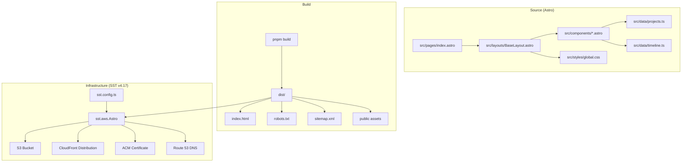
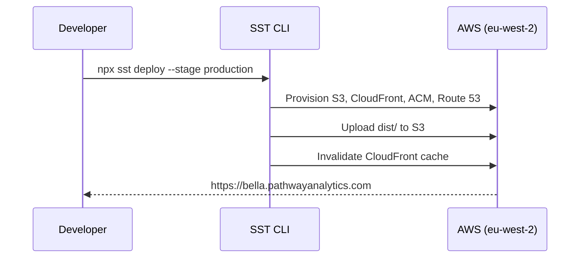

# Design Document: Bella Portfolio Site

## Overview

This design describes the architecture for a static portfolio website for Bella Grant / Pathway Analytics. The site is built with Astro v5.9.4, deployed to AWS via SST v4.17 (Ion), and must be a pixel-perfect reproduction of the provided reference HTML (`context/index.html`).

The primary concerns are:
1. **Visual fidelity** — exact reproduction of the reference design including typography, colours, spacing, responsive breakpoints, and micro-interactions
2. **Content maintainability** — structured data and clear component boundaries so a non-technical Content Author can update project entries
3. **Infrastructure as code** — reproducible staging and production deployments via SST with custom domain support
4. **Performance and accessibility** — font preloading, semantic HTML, keyboard focus styles, and `prefers-reduced-motion` support

### Design Decisions

| Decision | Choice | Rationale |
|----------|--------|-----------|
| Static output mode | Astro `output: 'static'` (default) | No server-side rendering needed; pure static HTML/CSS/JS |
| Package manager | pnpm | Already specified in requirements; fast, disk-efficient |
| SST version | v4.17 (Ion) | User requirement; uses `sst.config.ts` with `$config()` pattern |
| SST component | `sst.aws.Astro` | Native Astro support with CloudFront + S3 + ACM built-in |
| Content data format | TypeScript arrays in `src/data/` | Type-safe, co-located, easy for Content Authors to edit |
| CSS approach | Global stylesheet in Astro `<style is:global>` | Mirrors the reference HTML's single-file CSS structure; no build-time CSS framework needed |
| Image handling | Extract base64 portrait to `public/portrait.jpg` | Reduces page weight, enables CDN caching |

## Architecture



### Deployment Flow



## Components and Interfaces

### Page Structure

The site is a single-page application with one Astro page (`src/pages/index.astro`) that composes all section components within a base layout.

### Layout Component

**`src/layouts/BaseLayout.astro`**

Responsible for:
- `<html>` element with `lang="en"` and `scroll-behavior: smooth` on `:root`
- `<head>` with meta tags, Open Graph tags, Google Fonts preconnect/link, and critical CSS inlining
- `<body>` wrapper with slot for page content
- Footer script for dynamic copyright year
- IntersectionObserver script for timeline animation

### Section Components

| Component | File | Content Source |
|-----------|------|----------------|
| Navigation | `src/components/Nav.astro` | Static (brand text + anchor links) |
| Hero | `src/components/Hero.astro` | Static (eyebrow, headline, copy, CTA) |
| Route (Timeline) | `src/components/Route.astro` | `src/data/timeline.ts` |
| Offer (What I do) | `src/components/Offer.astro` | Static (3 cards) |
| Methods (How I work) | `src/components/Methods.astro` | Static (4 cards) |
| Proof (Statistics) | `src/components/Proof.astro` | Static (4 figures) |
| Projects (Selected work) | `src/components/Projects.astro` | `src/data/projects.ts` |
| About | `src/components/About.astro` | Static (biographical text) |
| Publications | `src/components/Publications.astro` | Static (4 publications list) |
| Contact | `src/components/Contact.astro` | Static (CTA + contact details) |
| Footer | `src/components/Footer.astro` | Static (copyright with dynamic year) |

### Shared Concerns

**`src/styles/global.css`** — Contains all CSS custom properties, base resets, component styles, responsive media queries, and animation keyframes. This is a direct translation of the `<style>` block from the reference HTML.

**`public/portrait.jpg`** — Extracted portrait image served as a static asset.

**`public/robots.txt`** — Permits all crawlers.

**`src/pages/sitemap.xml.ts`** — Generates XML sitemap (or uses `@astrojs/sitemap` integration).

### SST Configuration Interface

```typescript
// sst.config.ts
/// <reference path="./.sst/platform/config.d.ts" />

export default $config({
  app(input) {
    return {
      name: "bella-pathwayanalytics",
      removal: input?.stage === "production" ? "retain" : "remove",
      home: "aws",
      providers: {
        aws: {
          region: "eu-west-2",
        },
      },
    };
  },
  async run() {
    const stage = $app.stage;
    const domain =
      stage === "production"
        ? "bella.pathwayanalytics.com"
        : `bella-${stage}.pathwayanalytics.com`;

    new sst.aws.Astro("BellaPortfolio", {
      domain: {
        name: domain,
        dns: sst.aws.dns(),
      },
    });
  },
});
```

## Data Models

### Project Card

```typescript
// src/data/projects.ts
export interface ProjectCard {
  tag: string;           // e.g. "Funding & payment design"
  title: string;         // e.g. "Integrated Sexual Health Tariff"
  paragraphs: string[];  // 1-2 description paragraphs
  outcomeLabel: string;  // "Outcome" | "Decision" | "Value"
  outcomeText: string;   // outcome description
  isCurrent?: boolean;   // highlights card with teal border
}

export const projects: ProjectCard[] = [
  // ... 8 project entries
];
```

### Timeline Station

```typescript
// src/data/timeline.ts
export interface TimelineStation {
  yearRange: string;     // e.g. "1995–2009"
  role: string;          // e.g. "Investment Banking & Strategy Consulting"
  organisation: string;  // description of org/role context
  isNow?: boolean;       // applies highlight colour to role text
}

export const stations: TimelineStation[] = [
  // ... 6 timeline entries
];
```

### CSS Custom Properties (Design Tokens)

```css
:root {
  --ink: #131b2b;
  --ink-soft: #344157;
  --paper: #eeede4;
  --paper-hi: #f8f7f1;
  --brass: #9b7627;
  --brass-soft: #c7a75e;
  --teal: #205d58;
  --teal-deep: #174742;
  --line: #c9c5b7;
  --line-dark: #3b465b;
  --white: #ffffff;
}
```

## Correctness Properties

Property-based testing is **not applicable** to this feature. The project consists of:

1. **Infrastructure as Code** (SST/AWS deployment) — declarative configuration with no varying inputs
2. **Static HTML/CSS rendering** (Astro components) — visual output best validated with snapshot/visual regression tests
3. **Simple data structures** (project cards, timeline stations) — no transformation logic, just display
4. **CSS/layout behaviour** — responsive breakpoints are deterministic and viewport-dependent

There are no pure functions with meaningful input variation, no serialization round-trips, no algorithms, and no business logic that would benefit from property-based testing. The testing strategy below uses appropriate alternatives.

## Error Handling

### Build-Time Errors

| Scenario | Handling |
|----------|----------|
| Missing data imports | TypeScript compiler catches missing/malformed data at build time |
| Invalid Astro component syntax | Astro build fails with clear error messages |
| Missing public assets (portrait.jpg) | Build succeeds but broken image visible in preview — caught by visual review |
| SST config errors | `sst deploy` fails with descriptive error before any AWS resource creation |

### Runtime Errors

| Scenario | Handling |
|----------|----------|
| IntersectionObserver not supported | Fallback: add `in-view` class immediately (line-track shows final drawn state) |
| JavaScript disabled | Site renders fully without JS; only dynamic copyright year and timeline animation are JS-dependent |
| Google Fonts fail to load | `font-display: swap` on font link; fallback system fonts defined in font stacks (`Arial`, `Georgia`, `monospace`) |
| CloudFront 404 | Astro generates a `404.html` for graceful handling |

### Deployment Errors

| Scenario | Handling |
|----------|----------|
| DNS not yet propagated | SST retries ACM validation; manual instructions provided for external DNS |
| AWS credentials missing | SST CLI provides clear error message before attempting deployment |
| Stage name collision | SST uses stage-namespaced resource names to prevent conflicts |

## Testing Strategy

### Unit Tests (Example-Based)

Since this is a static site with no business logic, traditional unit tests focus on:

1. **Data integrity tests** — Verify `projects.ts` and `timeline.ts` exports have correct structure and required fields
2. **Build output tests** — Run `pnpm build` and assert:
   - `dist/index.html` exists and contains expected section IDs
   - `dist/robots.txt` exists with correct content
   - `dist/sitemap-index.xml` exists and is valid XML
3. **Content completeness tests** — Parse built HTML and verify all 8 project cards, 6 timeline stations, 4 proof figures are present

### Visual / Snapshot Tests

4. **Responsive layout verification** — Use Playwright or similar to screenshot at 1200px, 960px, 790px, and 560px viewpoints and compare against reference baselines
5. **CSS custom property verification** — Parse the built CSS and assert all 11 design tokens are present with correct values

### Accessibility Tests

6. **Lighthouse CI** — Run in CI pipeline; assert accessibility score ≥ 95
7. **axe-core** — Automated accessibility audit on built HTML to catch missing ARIA labels, colour contrast issues, focus management problems

### Integration Tests

8. **IntersectionObserver animation** — Playwright test: scroll to `.line-track`, verify `.in-view` class is added
9. **Reduced motion** — Playwright test with `prefers-reduced-motion: reduce` emulation; verify `scroll-behavior: auto` and no animation

### Deployment Smoke Tests

10. **Post-deploy health check** — After `sst deploy`, verify HTTPS response at custom domain returns 200 with expected `<title>` tag
11. **Asset resolution** — Verify `portrait.jpg` and font files load correctly from CDN (no broken relative paths)

### Test Tooling

| Tool | Purpose |
|------|---------|
| Vitest | Data integrity and build output assertions |
| Playwright | Visual regression, accessibility, interaction tests |
| axe-core (via @axe-core/playwright) | Accessibility automation |
| Lighthouse CI | Performance and accessibility scoring in CI |

### CI Pipeline

```yaml
# Conceptual pipeline stages
build → test:unit → test:visual → deploy:staging → test:smoke → deploy:production
```

All tests run against the built output (`dist/`), not against source files, ensuring what is tested matches what is deployed.
